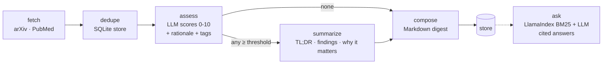

# research-radar

**An LLM agent that keeps you on top of the literature.** It watches arXiv and PubMed for the topics you care about, uses an LLM to score each new paper against a plain-English brief, summarizes the ones that matter, and writes a Markdown digest. Everything it screens is kept, so you can later ask questions across the whole history and get cited answers.

Built with **LangGraph** (agent orchestration), **LangChain** (provider-agnostic chat models), and **LlamaIndex** (BM25 retrieval for Q&A). It works with Anthropic Claude, OpenAI, Azure OpenAI, AWS Bedrock, or a local model through Ollama.

## Why

Reading every new paper in a fast-moving field doesn't scale, and keyword alerts are noisy. A brief like *"physics + ML hybrids validated on real industrial data; toy PDE benchmarks are low priority"* captures what you actually want, and an LLM can apply it consistently across hundreds of abstracts. research-radar turns that into a repeatable, auditable pipeline: every score comes with a rationale, and summaries are constrained to facts stated in the abstract.

## How it works



| Node | What it does | Design notes |
|---|---|---|
| `fetch` | Queries each configured source | A failing source is logged and skipped, not fatal. Respects arXiv (3 s) and NCBI (3 req/s) rate limits |
| `dedupe` | Drops papers already seen for this topic | SQLite, so repeated runs (e.g. a weekly cron) only surface new work |
| `assess` | LLM scores relevance against the topic brief | Parallel calls; JSON validated by Pydantic, with one self-correcting retry on malformed output |
| `summarize` | Structured summary for papers above the threshold | Prompted to use only facts in the abstract |
| `compose` | Renders the digest and persists all scores | Low-scoring papers are stored too, so `ask` can search everything |
| `ask` | Retrieval-augmented Q&A over stored papers | BM25 (no embedding model or vector DB needed); answers cite `[1]`, `[2]` |

**Provider-agnostic structured output.** Rather than depending on one vendor's function-calling API, the agent asks for JSON, extracts it robustly (code fences, surrounding chatter), validates it against a Pydantic schema, and feeds validation errors back to the model once. That lets the same pipeline run on frontier APIs and on small local models.

## Quick start

```bash
git clone https://github.com/faazeli/research-radar && cd research-radar
uv sync                                   # or: pip install -e .
cp config.example.yaml config.yaml        # edit topics, briefs, provider

export ANTHROPIC_API_KEY=...              # or OPENAI_API_KEY, or run Ollama locally
uv run research-radar sources             # dry run: check your queries return papers (no LLM calls)
uv run research-radar run                 # screen, summarize, write digests/
uv run research-radar ask "Which papers validate PINNs on field data?"
```

Run fully locally with Ollama:

```bash
ollama pull llama3.2
uv run research-radar run --provider ollama --model llama3.2
```

## Configuration

```yaml
llm:
  provider: anthropic          # anthropic | openai | ollama | azure_openai | bedrock_converse
topics:
  - name: ai-oil-gas-ops
    title: AI for Oil & Gas Production Operations
    brief: >
      AI and automation for upstream production: artificial lift, production forecasting,
      predictive maintenance, anomaly detection on well sensor data. Field-validated results matter most.
    min_relevance: 6           # papers below this are stored but left out of the digest
    max_in_digest: 10
    sources:
      - name: arxiv
        query: '(abs:"artificial lift" OR abs:"production forecasting") AND abs:learning'
```

See [`config.example.yaml`](config.example.yaml) for three worked topics (arXiv and PubMed).

## Tests

```bash
uv run pytest
```

The tests run the **entire LangGraph pipeline offline**: real arXiv and PubMed API responses are stored as fixtures, and a scripted fake chat model stands in for the LLM. They cover parsing, the relevance threshold, de-duplication across runs, recovery from malformed model output, a failing source, and BM25 retrieval for `ask`.

## Extending

- **New source:** add a `fetch_<name>(query, max_results) -> list[Paper]` to `sources.py` and register it in `FETCHERS`.
- **New step:** add a node in `graph.py`, e.g. a critic that double-checks summaries against the abstract.
- **Delivery:** pipe the digest to Slack or email from a scheduled job.

## License

MIT
